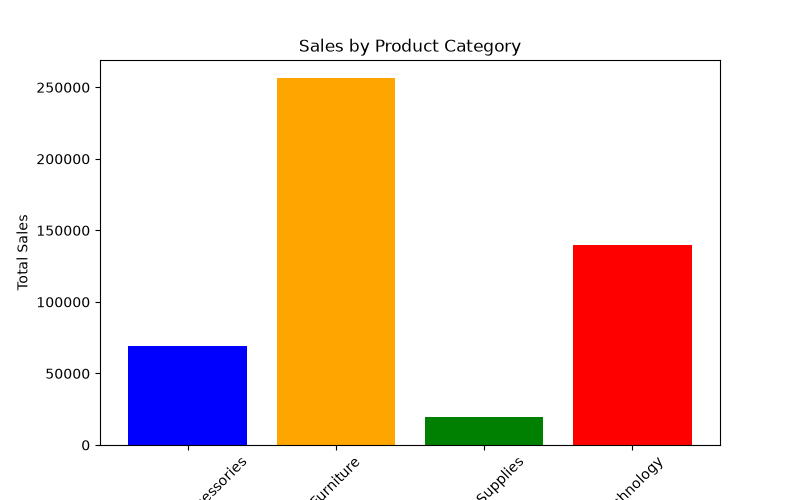
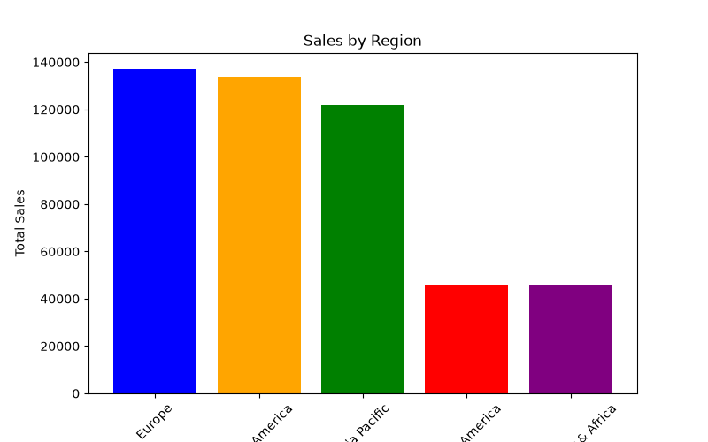
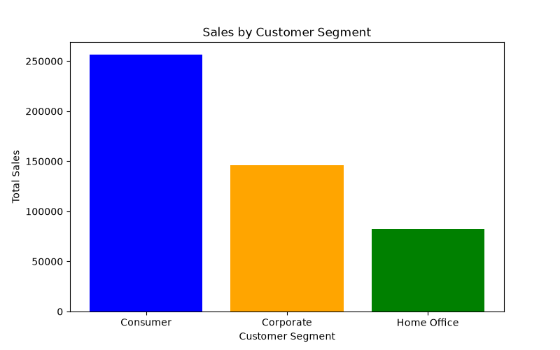
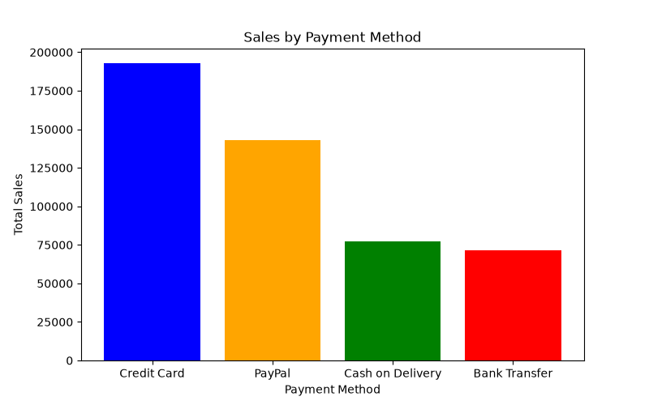

# E-Commerce Sales Analysis

An exploratory data analysis project using Python to understand e-commerce sales, profitability, customer segments, product categories, and sales trends from 2023 to 2025.

## Project Overview

I analyzed 2,000 e-commerce records to explore business performance and identify patterns across products, regions, customer segments, and payment methods.

**Tools & Libraries:** Python, Pandas, NumPy, Matplotlib

## Key Findings

- **Overall performance:** The dataset recorded $484,559.34 in sales and $158,872.32 in profit, with an overall profit margin of approximately 32.79%.
- **Yearly trend:** Sales decreased by 5.65% in 2024, then increased by 6.33% in 2025.
- **Product categories:** Furniture contributed the highest sales, approximately $256,274.68, and generated approximately $81,171.57 in profit.
- **Regional performance:** Europe recorded the highest total sales, at $137,006.20.
- **Customer segments:** Consumer customers contributed the largest share of sales, at $256,287.74.
- **Sales distribution:** Mean sales ($242.28) were higher than median sales ($113.13), indicating that larger transactions pulled the average upward.

## Visualizations

### Sales by Product Category


### Sales by Region


### Sales by Customer Segment


### Sales by Payment Method


## Analysis Performed

- Inspected dataset structure, data types, missing values, and duplicate records.
- Converted dates and analyzed yearly and monthly sales trends.
- Compared sales and profit across categories, regions, customer segments, and payment methods.
- Used NumPy for descriptive statistics and percentile analysis.
- Created visualizations using Matplotlib to communicate findings.

## How to Run

1. Clone or download this repository.
2. Install the required libraries:

   ```bash
   pip install -r requirements.txt
3. Open the Jupyter Notebook.

4. Make sure the dataset is available at the file path used in the notebook.

5. Run the notebook cells.